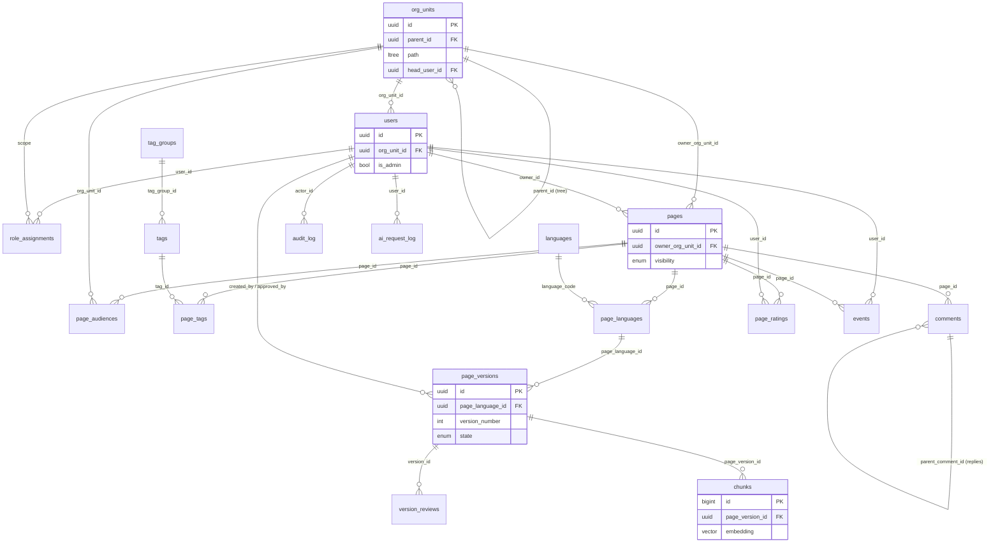

# SkyKnow MVP Data Model Guide

A plain-language guide to the 18 tables in `skyknow_mvp_schema.sql`: what each table is for, how the tables connect, and a worked example that follows real rows through the system.

---

## Table of contents

1. [The big picture](#1-the-big-picture)
2. [Entity relationship diagram](#2-entity-relationship-diagram)
3. [The tables, group by group](#3-the-tables-group-by-group)
4. [Relationship cheat sheet](#4-relationship-cheat-sheet)
5. [Worked example: one page from start to finish](#5-worked-example-one-page-from-start-to-finish)
6. [Who can read what: the visibility rules](#6-who-can-read-what-the-visibility-rules)
7. [Who can write, review and publish: the role rules](#7-who-can-write-review-and-publish-the-role-rules)
8. [Rules the database enforces for you](#8-rules-the-database-enforces-for-you)
9. [Useful queries](#9-useful-queries)
10. [What is NOT in the MVP](#10-what-is-not-in-the-mvp)

---

## 1. The big picture

SkyKnow is a company library. Every table answers one of four questions.

| Question | Tables |
|---|---|
| **Who works here and where do they sit?** | `languages`, `org_units`, `users` |
| **What are they allowed to do?** | `role_assignments` |
| **What knowledge exists and what stage is it in?** | `pages`, `page_languages`, `page_versions`, `version_reviews`, `page_audiences`, `tag_groups`, `tags`, `page_tags`, `comments`, `page_ratings` |
| **How is it searched, and what happened?** | `chunks`, `events`, `audit_log`, `ai_request_log` |

Three ideas explain most of the design:

1. **Where you sit decides what you can READ.** Your position in the org tree is matched against the page's audience.
2. **Your role decides what you can DO.** Author, reviewer and publisher are granted on a unit and cover everything below it.
3. **A page is a folder, and the text lives in numbered versions inside it.** Only a `published` version is ever shown to readers.

---

## 2. Entity relationship diagram

Each line reads "one ... has many ...". Only the important columns are shown.



---

## 3. The tables, group by group

### 3.1 People and structure

#### `languages`
A short lookup list of supported languages: `en`, `am`, `om`.

- **Why a table and not fixed text?** Adding the 4th and 5th language later is one `INSERT`, not a code change.
- **Used by:** `users.preferred_language`, `page_languages.language_code`.

#### `org_units`
Your org chart from the whiteboard photo. **One row per box.**

| Column | Meaning |
|---|---|
| `parent_id` | The box above. `NULL` for the CEO (the root). |
| `label` | Machine name, for example `call_center`. |
| `name` | Display name, for example "Call Center". |
| `path` | The full folder-style path, for example `ceo.chief_cs.fo.call_center`. A trigger maintains it. |
| `head_user_id` | The person who leads this unit. The database guarantees the head is a member of the unit. |

**Why `path`?** To find everything under Call Center you ask for paths that start with `ceo.chief_cs.fo.call_center`. That is one fast indexed query, with no loops.

#### `users`
One row per staff member. There are **no passwords**, because login comes from Ethio Telecom single sign-on.

| Column | Meaning |
|---|---|
| `org_unit_id` | The box this person sits in. **This controls what they can read.** |
| `is_admin` | System administrator flag (manage users, units, tags). |
| `status` | `active` or `disabled`. Disabled users keep their history. |
| `external_id` | The id from the single sign-on system. |

A person belongs to **exactly one** unit.

---

### 3.2 Roles

#### `role_assignments`
A list of sentences of the form "**this user** is a **role** at **this unit**".

| user | role | unit | In plain words |
|---|---|---|---|
| Coach 1 | `author` | Coach 1's team | Coach 1 can write pages owned by their team |
| Supervisor A | `reviewer` | Supervisor A | Supervisor A can review pages owned by their branch |
| Call Center manager | `publisher` | Call Center | The manager can publish pages owned anywhere under Call Center |

**Scope rule:** a role covers the unit it is granted on **and every unit below it**.

---

### 3.3 Knowledge

#### `pages`
The "folder label" for one knowledge item. It holds **no text**, only information about the item.

| Column | Meaning |
|---|---|
| `template` | `howto`, `faq` or `policy`. |
| `owner_org_unit_id` | The unit that owns the page. Role scopes are checked against this. |
| `owner_id` | The person responsible for it. |
| `visibility` | `restricted` (default, only audiences listed in `page_audiences`) or `all_staff`. |
| `is_customer_visible` | Whether customer channels (chatbot, app) may show it. |
| `review_interval_months`, `next_review_at` | When the page must be re-checked. |
| `archived_at` | Pages are archived, never deleted. |

#### `page_audiences`
"Who is this page FOR?" One row per audience unit.

| Column | Meaning |
|---|---|
| `org_unit_id` | The audience unit. |
| `include_descendants` | `true` means this unit **and everything below it**. `false` means **only this exact unit** (this is how CEO-only works). |

#### `page_languages`
One row per page per language. The **English** and **Amharic** versions of the same page are separate rows with separate workflows, so a translation waiting for review never blocks the English page.

#### `page_versions`
The actual text. Each save-and-submit creates a numbered version.

| Column | Meaning |
|---|---|
| `version_number` | 1, 2, 3 ... unique per page language. |
| `title`, `summary`, `content` | The text. `content` is a JSON object of blocks. |
| `content_text` | Plain-text copy of the content, used for chunking and AI. |
| `state` | `draft` → `in_review` → `approved` → `published` → `archived`. |
| `created_by`, `approved_by`, `published_by` | Who did each step. |
| `scheduled_publish_at` | Optional "go live at this time". |
| `is_ai_generated`, `ai_origin` | Marks AI drafts and translations so reviewers know. |

Behaviour to remember:

- **Only `published` is shown to readers.**
- A **draft is editable**. Once submitted, its content is **frozen**.
- Editing a live page creates a **new draft**. The old version stays live until the new one is published.

#### `version_reviews`
The reviewer's notes. One row per approve or reject decision. A rejection **must** have a comment. This keeps the history of why a version was sent back, even after the author fixes it.

#### `tag_groups`, `tags`, `page_tags`
Labels for filtering.

- `tag_groups`: Product, Process, Fault.
- `tags`: "Prepaid", "SIM swap", "No signal" (each belongs to one group).
- `page_tags`: the many-to-many link between pages and tags.

#### `comments`
Discussion on a page. A reply points to its parent through `parent_comment_id`, and the database ensures a reply is on the **same page** as its parent. Threads can be marked resolved. Deleted comments are soft-deleted so threads stay intact.

#### `page_ratings`
One row per user per page, holding stars (1 to 5) and/or helpful yes/no. A user's second rating **updates** the first.

---

### 3.4 Search

#### `chunks`
The search index. When a version is published, its text is cut into small pieces. Each piece is stored with:

- `body`: the text of the piece,
- `heading_path`: where it sits, for example "Reset a PIN > Steps",
- `embedding`: 1,536 numbers capturing the piece's **meaning**,
- `tsv`: a keyword index, built automatically from the text.

Search compares your question's numbers with the stored numbers to find the closest meaning. Keyword search runs alongside it.

**Two rules:**

1. Only **live** content is in this table. When a page is unpublished or replaced, its chunks are deleted.
2. **Visibility is not copied here.** At search time we ask `user_can_view_page(...)`, so there is only one place where permissions live and a stale copy can never leak a page.

---

### 3.5 History and numbers

#### `events`
Every page view, search, search click, "insert into reply" action, rating and comment.

- Powers "hot knowledge" (most-viewed pages).
- Powers "knowledge gaps": searches that returned zero results.

#### `audit_log`
Who did what to which object, with before and after values. **Append-only**: a trigger blocks any update or delete.

#### `ai_request_log`
One row per call to the AI provider: feature, model, tokens, cost, speed, status. Needed from day one to keep AI spending visible.

---

## 4. Relationship cheat sheet

| From (child) | Column | Points to (parent) | Relationship |
|---|---|---|---|
| `org_units` | `parent_id` | `org_units` | Many children → one parent (the tree) |
| `org_units` | `head_user_id` | `users` | One unit → one head, who must be a member |
| `users` | `org_unit_id` | `org_units` | Many users → one unit |
| `users` | `preferred_language` | `languages` | Many users → one language |
| `role_assignments` | `user_id` | `users` | A user can hold many roles |
| `role_assignments` | `org_unit_id` | `org_units` | The scope of the role |
| `pages` | `owner_org_unit_id` | `org_units` | The unit that owns the page |
| `pages` | `owner_id`, `created_by` | `users` | Responsible person and creator |
| `page_audiences` | `page_id` | `pages` | A page can have many audiences |
| `page_audiences` | `org_unit_id` | `org_units` | Each audience is one unit |
| `page_tags` | `page_id`, `tag_id` | `pages`, `tags` | Many-to-many |
| `tags` | `tag_group_id` | `tag_groups` | Many tags → one group |
| `page_languages` | `page_id` | `pages` | A page has one row per language |
| `page_languages` | `language_code` | `languages` | |
| `page_versions` | `page_language_id` | `page_languages` | A page language has many versions |
| `page_versions` | `created_by`, `approved_by`, `published_by` | `users` | Who did each step |
| `page_versions` | `based_on_version_id` | `page_versions` | A restore or copy points to its source |
| `version_reviews` | `version_id` | `page_versions` | A version can have many review decisions |
| `version_reviews` | `reviewer_id` | `users` | |
| `comments` | `page_id`, `user_id` | `pages`, `users` | |
| `comments` | `parent_comment_id` | `comments` | A reply points to its parent |
| `page_ratings` | `page_id`, `user_id` | `pages`, `users` | One rating per user per page |
| `chunks` | `page_version_id` | `page_versions` | A version produces many chunks |
| `chunks` | `page_language_id`, `page_id`, `language_code` | `page_languages` | Must match the version's real hierarchy |
| `events` | `user_id`, `page_id`, `page_version_id` | `users`, `pages`, `page_versions` | Set to NULL if the target disappears |
| `audit_log` | `actor_id` | `users` | NULL means a system job |
| `ai_request_log` | `user_id`, `page_version_id` | `users`, `page_versions` | |

### Reading the chain from top to bottom

```
org_units ── users ── role_assignments
    │
    └── pages ── page_audiences
          │  └── page_tags ── tags ── tag_groups
          │
          └── page_languages ── page_versions ── version_reviews
                                     │
                                     └── chunks
```

To get from a search hit to its owner: `chunks → page_versions → page_languages → pages → org_units`.

---

## 5. Worked example: one page from start to finish

### 5.1 The setup (your org chart as rows)

**`org_units`**

| name | parent | path |
|---|---|---|
| CEO | (none) | `ceo` |
| Chief Customer Service | CEO | `ceo.chief_cs` |
| Back Office | Chief CS | `ceo.chief_cs.bo` |
| Front Office | Chief CS | `ceo.chief_cs.fo` |
| Digital Channels | Front Office | `ceo.chief_cs.fo.digital` |
| Call Center | Front Office | `ceo.chief_cs.fo.call_center` |
| Supervisor A | Call Center | `ceo.chief_cs.fo.call_center.sup_a` |
| Coach 1's team | Supervisor A | `ceo.chief_cs.fo.call_center.sup_a.coach_1` |
| Supervisor B | Call Center | `ceo.chief_cs.fo.call_center.sup_b` |

**`users`**

| name | sits in (`org_unit_id`) | Note |
|---|---|---|
| CEO | CEO | head of CEO |
| Chief CS | Chief Customer Service | head |
| BO officer | Back Office | |
| Call Center manager | Call Center | head |
| Supervisor A | Supervisor A | head |
| Supervisor B | Supervisor B | head |
| Coach 1 | Coach 1's team | head |
| Agent 1 | Coach 1's team | member |

**`role_assignments`**

| user | role | unit |
|---|---|---|
| Coach 1 | `author` | Coach 1's team |
| Supervisor A | `reviewer` | Supervisor A |
| Supervisor B | `reviewer` | Supervisor B |
| Call Center manager | `publisher` | Call Center |

---

### 5.2 Step 1: the coach creates the page

Coach 1 wants a how-to called **"How to reset a PIN"**, for their own team and everyone in it.

**`pages`** (1 row)

| id | template | owner_org_unit | visibility | created_by |
|---|---|---|---|---|
| P1 | `howto` | Coach 1's team | `restricted` | Coach 1 |

**`page_audiences`** (1 row)

| page | org_unit | include_descendants |
|---|---|---|
| P1 | Coach 1's team | `true` |

**`page_languages`** (1 row)

| id | page | language |
|---|---|---|
| PL1 | P1 | `en` |

**`page_versions`** (1 row)

| id | page_language | version_number | title | state | created_by |
|---|---|---|---|---|---|
| V1 | PL1 | 1 | Reset a PIN | `draft` | Coach 1 |

> The database checks that Coach 1 holds the `author` role over a page owned by "Coach 1's team". If **Agent 1** tried to create this version, the insert would be rejected.

---

### 5.3 Step 2: submit for review

Coach 1 finishes editing and clicks Submit.

| id | state | submitted_at |
|---|---|---|
| V1 | `in_review` | 2026-10-27 09:00 |

From now on **V1's content is frozen**. Trying to change its title fails.

---

### 5.4 Step 3: the supervisor reviews

Supervisor A sees V1 in their review queue. Supervisor B does **not**, because V1's page is owned outside their branch.

Supervisor A approves.

**`version_reviews`** (1 row)

| version | reviewer | decision | comment |
|---|---|---|---|
| V1 | Supervisor A | `approved` | (none) |

**`page_versions`**

| id | state | approved_by | approved_at |
|---|---|---|---|
| V1 | `approved` | Supervisor A | 2026-10-27 10:00 |

Three things the database would have refused here:

- **Coach 1 approving their own work**: the approver can never be the author.
- **Supervisor B approving**: not a reviewer within this page's scope.
- **A rejection with no comment.**

---

### 5.5 Step 4: the manager publishes

The Call Center manager holds `publisher` at Call Center, which covers Coach 1's team.

| id | state | published_by | published_at |
|---|---|---|---|
| V1 | `published` | Call Center manager | 2026-10-27 11:00 |

> **Supervisor A cannot publish.** They are a reviewer, not a publisher. In your MVP you can also grant reviewers the publisher role in the same scope to make approving and publishing one step.

---

### 5.6 Step 5: the search index is built

A background job notices V1 is published, cuts the text into pieces, asks the AI for each piece's embedding, and writes the results.

**`chunks`** (3 rows)

| id | page_version | chunk_index | heading_path | body | embedding |
|---|---|---|---|---|---|
| 1 | V1 | 0 | Reset a PIN | "Use this when a customer forgot their PIN ..." | `[0.021, -0.113, ...]` |
| 2 | V1 | 1 | Reset a PIN > Steps | "1. Verify the customer's identity ..." | `[0.054, 0.007, ...]` |
| 3 | V1 | 2 | Reset a PIN > Notes | "A PIN can only be reset 3 times per day ..." | `[-0.012, 0.098, ...]` |

Also written: one row in **`ai_request_log`** per embedding call (tokens and cost), and one row in **`audit_log`**: `version.publish` by the Call Center manager.

---

### 5.7 Step 6: people use it

**Agent 1 searches "customer forgot PIN":**

1. The question is turned into an embedding.
2. The 100 closest chunks are found.
3. `user_can_view_page(Agent 1, P1)` is checked. Agent 1 sits in Coach 1's team, which is the audience, so **allowed**.
4. The best 10 are returned with their page and section for citation.

**A Back Office user searches the same words:** the same chunks match, but `user_can_view_page` returns **false**, so the page never appears.

**`events`** gets rows such as:

| event_type | user | page | query_text | result_count |
|---|---|---|---|---|
| `search` | Agent 1 | (none) | customer forgot PIN | 3 |
| `page_view` | Agent 1 | P1 | | |
| `search` | BO officer | (none) | customer forgot PIN | 0 |

The last row counts as a **knowledge gap** signal (zero results for that person).

Agent 1 then leaves a rating:

**`page_ratings`**

| page | user | stars | helpful |
|---|---|---|---|
| P1 | Agent 1 | 5 | `true` |

---

### 5.8 Step 7: the page is edited later

Six months later, Coach 1 spots a change in the PIN policy.

1. A **new draft V2** is created in the same `page_languages` row (PL1). V1 stays published and keeps serving readers.
2. V2 goes through review the same way.
3. At publish time, in **one transaction**: V1 becomes `archived`, then V2 becomes `published`.
4. V1's chunks are deleted and V2's chunks are created.

**`page_versions`** after step 3:

| id | version_number | state |
|---|---|---|
| V1 | 1 | `archived` |
| V2 | 2 | `published` |

The unique rule "at most one published version per page language" makes it **impossible** to have two live versions at once.

---

### 5.9 Step 8: a second language

Someone adds an Amharic translation.

**`page_languages`** gets a second row: (P1, `am`) = PL2.
V1 and V2 belong to PL1 (English). The Amharic version starts at its own version 1 under PL2, with its **own** draft → review → publish workflow. A pending Amharic draft never blocks the live English page.

---

## 6. Who can read what: the visibility rules

A user can read a **published** page if **any** of the following is true (this logic lives in `user_can_view_page`):

1. The page's `visibility` is `all_staff`.
2. The user sits in an audience unit.
3. The user sits **below** an audience unit and `include_descendants` is `true`.
4. The user is the **head** of a unit that contains an audience unit (managers oversee their subtree).

### Example matrix

Three pages:

- **A**: how-to for Coach 1's team, `include_descendants = true`
- **X**: CEO-only, audience = CEO unit, `include_descendants = false`
- **F**: for Front Office, `include_descendants = true`

| Viewer | A (coach page) | X (CEO-only) | F (Front Office) |
|---|---|---|---|
| CEO | yes (oversight) | **yes** | yes (oversight) |
| Chief CS | yes (oversight) | no | yes (oversight) |
| Call Center manager | yes (oversight) | no | yes (below FO) |
| Supervisor A | yes (oversight) | no | yes |
| Agent 1 | **yes** (in audience) | no | yes |
| Supervisor B | no | no | yes |
| Digital staff | no | no | yes |
| Back Office | no | no | no |

Read it like this: **audiences flow downward**, **heads see downward too**, and `include_descendants = false` is how you make a page exclusive to one box.

---

## 7. Who can write, review and publish: the role rules

| Action | Who may do it | Rule |
|---|---|---|
| Create a version | A user with `author` over the page's owner unit | Trigger on insert |
| Submit for review | The author | State change `draft → in_review` |
| Approve | A user with `reviewer` over the page, **not the author** | Check constraint + trigger |
| Reject | A reviewer, **must write a comment** | Check constraint on `version_reviews` |
| Publish | A user with `publisher` over the page, an admin, or the scheduler | Trigger |
| Unpublish or supersede | State change `published → archived` | Allowed transition |

### How "scope" is checked

A role at unit **U** covers a page when the page's **owner unit's path starts with U's path**.

Example: Supervisor A has `reviewer` at `...call_center.sup_a`.

| Page owned by | Owner path | Starts with `...sup_a`? | Result |
|---|---|---|---|
| Coach 1's team | `...sup_a.coach_1` | yes | Supervisor A may review it |
| Supervisor B | `...call_center.sup_b` | no | Supervisor A may **not** review it |

---

## 8. Rules the database enforces for you

You do not have to remember these in application code. The database refuses the bad action anyway.

| Rule | Mechanism |
|---|---|
| A user's unit must exist; a unit's head must belong to it | Composite foreign key |
| A team tree can never contain a cycle | Trigger on `org_units` |
| A version can only move along `draft → in_review → approved → published → archived` | Trigger |
| A submitted version's content is frozen | Trigger |
| Only draft versions can be deleted | Trigger |
| Approver is never the author | Check constraint |
| Only a user with the right role in scope can create, approve or publish | Trigger |
| At most one work-in-progress version per page language | Partial unique index |
| At most one published version per page language | Partial unique index |
| A rejection needs a comment | Check constraint |
| A reply must be on the same page as its parent comment | Composite foreign key |
| A rating needs stars or helpful, and stars are 1 to 5 | Check constraints |
| A chunk's page and language can never disagree with the real hierarchy | Composite foreign keys |
| A search event needs query text and result count | Check constraint |
| The audit log cannot be edited or deleted | Trigger |
| Page visibility defaults to `restricted` (closed) | Column default |

---

## 9. Useful queries

### 9.1 Can this person read this page?

```sql
SELECT user_can_view_page(:user_id, :page_id);
```

### 9.2 What is waiting for my review?

```sql
SELECT v.id, v.title, v.submitted_at
FROM page_versions v
JOIN page_languages pl ON pl.id = v.page_language_id
WHERE v.state = 'in_review'
  AND v.created_by <> :me
  AND user_has_role_for_page(:me, 'reviewer', pl.page_id)
ORDER BY v.submitted_at;
```

### 9.3 The live version of a page in one language

```sql
SELECT v.*
FROM page_versions v
JOIN page_languages pl ON pl.id = v.page_language_id
WHERE pl.page_id = :page_id
  AND pl.language_code = 'en'
  AND v.state = 'published';
```

### 9.4 Everything under Call Center (the tree in action)

```sql
SELECT name
FROM org_units
WHERE path <@ 'ceo.chief_cs.fo.call_center'
ORDER BY path;
```

### 9.5 Permission-aware meaning search

```sql
WITH candidates AS (
  SELECT c.id, c.page_id, c.heading_path, c.body,
         c.embedding <=> :query_embedding AS distance
  FROM chunks c
  WHERE c.language_code = :lang
  ORDER BY c.embedding <=> :query_embedding
  LIMIT 100
)
SELECT *
FROM candidates
WHERE user_can_view_page(:user_id, page_id)
ORDER BY distance
LIMIT 10;
```

### 9.6 Hot knowledge this week

```sql
SELECT page_id, count(*) AS views
FROM events
WHERE event_type = 'page_view'
  AND occurred_at > now() - interval '7 days'
GROUP BY page_id
ORDER BY views DESC
LIMIT 10;
```

### 9.7 Knowledge gaps (searches that found nothing)

```sql
SELECT query_text, count(*) AS times
FROM events
WHERE event_type = 'search' AND result_count = 0
  AND occurred_at > now() - interval '30 days'
GROUP BY query_text
ORDER BY times DESC
LIMIT 20;
```

### 9.8 Pages overdue for review

```sql
SELECT id, next_review_at
FROM pages
WHERE archived_at IS NULL
  AND next_review_at < now()
ORDER BY next_review_at;
```

---

## 10. What is NOT in the MVP

These are planned in the SDS but deliberately left out so the first build stays small. Each can be added later without changing the tables above.

| Later feature | Tables to add |
|---|---|
| PDF and manual upload | `documents` (and a `document_id` on `chunks`) |
| Navigation menu tree | `navigation_links` |
| Favourites and reminders | `favourites`, `reminders` |
| In-app and email alerts | `notifications` (review-due can already be queried from `pages.next_review_at`) |
| Sourced Q&A log | `ask_queries` |
| Live call assist | `call_sessions`, `transcript_segments`, `suggestions` |
| Agent evaluation | `evaluation_results` |
| Staff in two units, or several roles with different rules | `user_units` table |

---

### Quick glossary

| Term | Meaning |
|---|---|
| **Embedding** | A list of numbers that captures the meaning of a piece of text, so "forgot PIN" can match "reset a PIN". |
| **Chunk** | A small piece of a page, stored with its embedding for search. |
| **Scope** | The unit a role is granted on. It covers that unit and everything below it. |
| **Audience** | The unit (and optionally everything below it) a page is meant for. |
| **Head** | The leader of a unit (manager, supervisor, coach). Heads can read content for their whole subtree. |
| **Frozen** | A submitted version whose content can no longer change. |
| **Soft delete** | Marking a row as removed (`archived_at`, `deleted_at`) instead of deleting it, so history stays intact. |