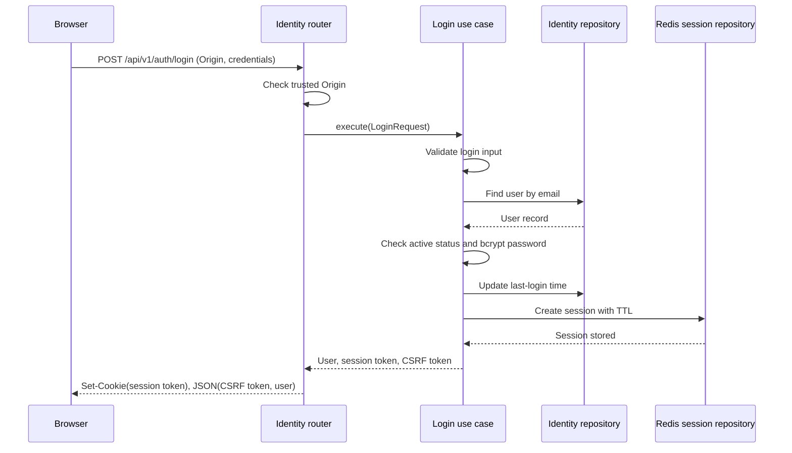

# Login and opaque-session flow

This document describes the current login flow implemented by the identity
module. Login authenticates credentials, creates an opaque server-side session
in Redis, and returns the session identifier only as an HTTP-only cookie.

## Components

- [`app/routers/identity.py`](../app/routers/identity.py) handles the HTTP
  endpoint, checks the request origin, sets the cookie, and shapes the response.
- [`app/modules/identity/application/functionality_usecases/login.py`](../app/modules/identity/application/functionality_usecases/login.py)
  validates credentials, checks the user, and creates the session.
- [`app/modules/identity/application/validation/auth.py`](../app/modules/identity/application/validation/auth.py)
  validates and normalizes login input.
- [`app/modules/identity/domain/identity_repository.py`](../app/modules/identity/domain/identity_repository.py)
  and [`app/modules/identity/domain/redis_repository.py`](../app/modules/identity/domain/redis_repository.py)
  define the persistence interfaces.
- [`app/modules/identity/infrastructure/sqlalchemy_identity_repository.py`](../app/modules/identity/infrastructure/sqlalchemy_identity_repository.py)
  implements user lookups and last-login updates.
- [`app/modules/identity/infrastructure/redis_repository.py`](../app/modules/identity/infrastructure/redis_repository.py)
  stores and retrieves sessions in Redis.
- [`app/modules/identity/wiring.py`](../app/modules/identity/wiring.py)
  provides the SQLAlchemy and Redis adapters to the login use case.
- [`app/config.py`](../app/config.py) contains session-cookie, lifetime, and
  allowed-origin settings.

## Login request

The endpoint is `POST /api/v1/auth/login`. It accepts a JSON body:

```json
{
  "email": "person@example.com",
  "password": "user-provided password"
}
```

The request must include an `Origin` header whose exact value is present in
`CORS_ALLOWED_ORIGINS`. The endpoint's `require_trusted_origin` dependency
rejects an absent or unlisted origin with `403 Forbidden`. CORS configuration
also restricts browser access to the configured origins and allows credentials.

## Processing sequence

1. **Parse and validate input.** FastAPI parses the JSON as `LoginRequest`.
   `validate_login_request` trims the email, checks its format, and enforces a
   password length of 1–72 UTF-8 bytes. Invalid input is rejected before
   credential verification.
2. **Look up the account.** The `Login` use case asks the identity repository
   for a user with that email.
3. **Authenticate the user.** Login fails with an authentication error if the
   account does not exist, is inactive, has no password hash, or the supplied
   password does not match the stored bcrypt hash. The same public error is
   used for these credential failures.
4. **Update last-login time.** On successful credential verification, the
   repository records the current UTC time as the user's last login.
5. **Create session credentials.** The use case generates independent,
   cryptographically secure opaque session and CSRF tokens with
   `secrets.token_urlsafe(32)`.
6. **Persist the session.** The Redis adapter hashes the session token with
   SHA-256 and uses that digest as the Redis key
   (`identity:session:<digest>`). The Redis hash stores the user ID and CSRF
   token, and expires after `SESSION_TTL_SECONDS`.
7. **Set the cookie and response.** The router sets the raw session token in
   the configured cookie. It is `HttpOnly`, has the configured `Secure` and
   `SameSite` attributes, uses path `/`, and has a `max_age` matching the
   session TTL. The JSON response contains the CSRF token and user profile;
   it does not contain the session token.



If authentication fails, the session is not created and no session cookie is
set. A database or Redis error is an infrastructure failure, not a successful
login response. The last-login update occurs before Redis session creation, so a
Redis failure may leave the last-login timestamp updated even though login
doesn't complete.

## Browser behavior after login

For a frontend hosted on a different site:

1. Send login with `credentials: "include"` so the browser accepts the
   `Set-Cookie` response.
2. Keep the returned CSRF token in frontend memory. Do not try to read the
   session cookie from JavaScript; it is HTTP-only.
3. Send `credentials: "include"` on subsequent API requests so the browser
   includes the cookie.
4. For state-changing requests (`POST`, `PUT`, `PATCH`, and `DELETE`), send the
   CSRF token in the `X-CSRF-Token` header. The API also checks the request's
   `Origin`.
5. After a reload, request `GET /api/v1/auth/csrf` with credentials to retrieve
   the CSRF token associated with the existing session.
6. To log out, call `POST /api/v1/auth/logout` with credentials and the CSRF
   header. Logout revokes the Redis session and clears the cookie.

Cross-site cookies require HTTPS when `SameSite=None`; configure
`SESSION_COOKIE_SECURE=true` in deployed environments. `CORS_ALLOWED_ORIGINS`
must contain the frontend's exact origin, including scheme and port where
applicable. Do not use wildcard origins with credentialed CORS.

## How later requests are authenticated

The `require_authenticated_user` dependency reads the session cookie and passes
its token to the `AuthenticateSession` use case. That use case retrieves the
session from Redis and looks up the user in the identity repository. Missing or
expired sessions, missing users, and inactive users are rejected; an invalid
user's session is revoked. For state-changing methods, the dependency checks the
trusted origin and compares `X-CSRF-Token` with the stored token using a
constant-time comparison. On success, the user ID and CSRF token are attached
to `request.state`.

The Redis connection is initialized and closed by the application lifespan in
[`app/main.py`](../app/main.py). It is shared by the Redis adapter through the
dependency in [`app/core/redis.py`](../app/core/redis.py).
